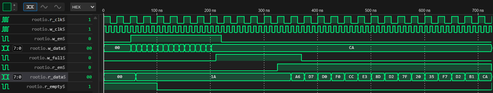
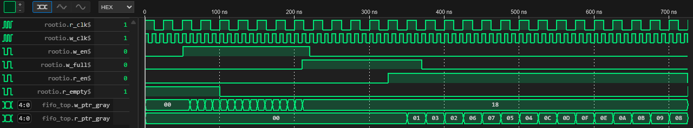

# Asynchronous FIFO Verification Suite 🚀


## 📌 Overview
This repository contains a fully verified, synthesizable Asynchronous FIFO designed in **SystemVerilog**, accompanied by a modern, randomized verification environment using **Python (Cocotb)** and a **C++ Golden Reference Model**.

This project demonstrates advanced digital design and verification concepts, including **Clock Domain Crossing (CDC)**, **Gray Code synchronization**, and multi-language verification bridging.

## 🏗️ Hardware Architecture (RTL)
The FIFO is designed to safely transfer data between two completely independent and asynchronous clock domains.
* **`fifo_top.sv`**: Manages the read/write pointers using Gray code to ensure only one bit toggles per clock cycle, preventing metastability.
* **`bit_sync.sv`**: A standard 2-stage flip-flop synchronizer used to safely pass the Gray code pointers across clock domains.
* **`fifo_mem.sv`**: A Dual-Port RAM with First-Word Fall-Through (FWFT) combinatorial read capabilities.

## 🧪 Verification Strategy
Instead of using legacy SystemVerilog testbenches, this project uses a highly efficient Python-based approach:
1. **C++ Golden Model:** A pure C++ implementation of a FIFO using `std::deque` acts as the absolute truth. Compiled as a shared library (`.so`).
2. **Software Bridge:** The C++ model is connected directly to the Python testbench using `ctypes` for seamless memory evaluation.
3. **Cocotb Regression Suite (`test_fifo.py`):**
   * **Test 1 (Half-Duplex):** Sequentially fills the FIFO until the `w_full` flag asserts, then reads until `r_empty`.
   * **Test 2 (Full-Duplex):** Simultaneously drives 10,000 randomized transactions on the Write clock while concurrently reading on the Read clock, heavily stressing the Clock Domain Crossing (CDC) logic.
5. **Functional Coverage:** Utilizes `cocotb-coverage` to mathematically prove perfect uniform data distribution (0-255) and rigorous exercising of the Full/Empty boundary conditions across both tests.

## 📁 Repository Structure
```text
async-fifo-verification-suite/
├── rtl/                    # SystemVerilog RTL Design
│   ├── bit_sync.sv         
│   ├── fifo_mem.sv         
│   └── fifo_top.sv         
├── model/                  # Golden Reference Model
│   └── cpp/                
│       └── fifo_model.cpp  # C++ implementation (std::deque)
├── verif/                  # Verification Environment
│   ├── dpi/                
│   │   └── dpi_wrapper.sv  
│   └── cocotb/             # Cocotb Testbench
│       ├── Makefile        # Verilator + Cocotb build script
│       └── test_fifo.py    # Python regression, monitor, and scoreboard
├── docs/                   # Simulation Waveforms
│   ├── wave1.png           
│   └── wave2.png           
├── .gitignore              # Keeps the repo clean of build files
└── README.md               # Project Documentation
```

## 🚀 How to Run the Simulation

### Prerequisites
* Linux (Ubuntu / WSL2)
* Python 3 + `cocotb` + `cocotb-coverage`
* Verilator (v5.036 or higher)
* `g++` and `make`

### Execution Steps
1. **Compile the C++ Golden Model:**
   ```bash
   cd verif/cocotb
   g++ -shared -fPIC -o fifo_model.so ../../model/cpp/fifo_model.cpp
   ```
2. **Run the Cocotb Regression & Coverage:**
   ```bash
   make
   ```
   *(To generate `.vcd` waveforms for viewing in GTKWave or VS Code WaveTrace, run `make WAVES=1`)*

## 📈 Waveform Analysis
Below are the simulation waveforms generated via Verilator, proving the successful Clock Domain Crossing and logic execution.

### 1. Data Flow & Protection (Full/Empty Flags)
*Notice how the `w_full` flag asserts immediately to protect the memory when depth is reached (after 16 items), and how data falls through asynchronously on the read side.*



### 2. Clock Domain Crossing & Gray Code
*Notice the `r_ptr_gray` and `w_ptr_gray` signals. They only flip exactly **one bit at a time**, proving the mathematical safety of the pointer crossing between the two asynchronous clocks.*



---
Designed and Verified by João Antunes | https://www.linkedin.com/in/joao-pedro-reis-antunes/
